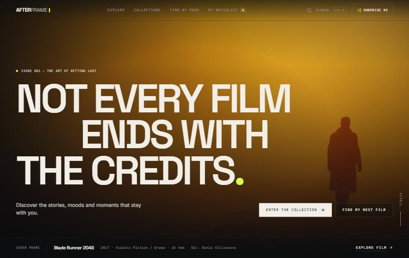

# AFTERFRAME

**Find the film that stays with you.**

[](https://github.com/NikitaMelnikit/afterframe/actions/workflows/ci.yml)

**Live demo:** [afterframe-mmrtrade.vercel.app](https://afterframe-mmrtrade.vercel.app)



AFTERFRAME is an editorial, mood-led film discovery platform: curated collections, discovery by
atmosphere, a searchable catalogue, film detail pages, persistent watchlists and an explainable
Mood Finder. It is an independent portfolio/demonstration project. It does not stream, sell or
host films.

**Stack:** React 19 · TypeScript · Vite 6 · Tailwind CSS 3 · Motion (Framer Motion) · React Router 7
(data router + View Transitions) · Lucide · TMDB API with a curated offline fallback.

---

## Quick start

```bash
npm install
npm run dev          # http://localhost:5173
```

The site works immediately, with no API key. It runs on the **curated offline edition** (see below).

| Script                   | What it does                                               |
| ------------------------ | ---------------------------------------------------------- |
| `npm run dev`            | Vite dev server with hot reload                            |
| `npm run build`          | Type-checks (`tsc -b`) and builds to `dist/`               |
| `npm run preview`        | Serves the production build locally                        |
| `npm run typecheck`      | TypeScript only                                            |
| `npm run lint`           | ESLint (typescript-eslint, react-hooks, react-refresh)     |
| `npm run verify:artwork` | Re-checks every offline artwork path against the TMDB CDN  |

Requires Node 20+ (developed on Node 24).

## Connecting TMDB (live data)

1. Create a free account at [themoviedb.org](https://www.themoviedb.org/) and request an API key
   under *Settings → API*.
2. Copy `.env.example` to `.env` and fill in **one** of:

   ```bash
   VITE_TMDB_API_KEY=your_v3_api_key
   # or
   VITE_TMDB_READ_TOKEN=your_v4_read_access_token
   ```

3. Restart `npm run dev`.

With a key configured:

- **Explore** queries `/discover/movie` and `/search/movie` across the whole catalogue, with a
  minimum-rating filter and rating sort (both hidden offline, because there are no verified ratings
  there).
- **Film pages** load `/movie/{id}` with credits, videos, recommendations and keywords in one
  request. They show real TMDB scores and vote counts, full cast and crew, and embed the official
  YouTube trailer when TMDB lists one.
- **Global search** queries TMDB.
- **Mood Finder** adds a "wider catalogue" rail from `/discover/movie`, filtered by genre, runtime
  and your viewing preference.

> `.env` is git-ignored. Never commit credentials. Note that any `VITE_` variable is embedded in the
> client bundle. That is acceptable for a read-only TMDB demo key, but a production product would
> proxy TMDB through a server.

## How the offline edition works

`src/data/films.ts` contains **93 curated films** spanning 1954–2024 and many genres, countries and
moods. Each record has:

- A **TMDB id**, so routes like `/film/27205` are identical in both modes.
- Title, year, runtime, genres, country, language, director and abridged principal cast.
- An **original** one- or two-sentence synopsis written for AFTERFRAME (not copied from any source),
  plus an optional editorial note.
- **Editorial mood tags** (`unsettling`, `wonder`, `mindbending`, …) and **traits** (`familiar`,
  `unusual`, `visual`, `intense`, `easy`) that power the Mood Finder. These are presented in the UI
  as opinions, never as ratings.

What the offline edition deliberately does **not** contain: ratings, vote counts, popularity
figures, reviews, awards or trailer ids. Those are only shown when they come from TMDB.

### Artwork

`src/data/artwork.json` maps each film to TMDB image-CDN paths. Every path was:

1. checked to resolve on `image.tmdb.org`, and
2. visually confirmed on a contact sheet to belong to the right film. Several paths that resolved
   but showed a different film were rejected.

Six films have no verified artwork and render a **designed fallback** instead: a palette-driven
poster composition with typography and a frame line. The same fallback is used whenever any remote
image fails to load at runtime. Run `npm run verify:artwork` to re-check the manifest.

## Architecture

```
src/
  data/
    types.ts              Shared domain models (MovieSummary, MovieDetail, Collection, …)
    films.ts              Curated offline edition + artwork merge
    artwork.json          Verified TMDB image paths
    collections.ts        Editorial collections (add one entry → new page, tile and route)
    moods.ts              Home moods, Mood Finder questions and labels
    matching.ts           Explainable scoring: mood finder, similarity, "your orbit"
    tmdb.ts               Typed TMDB client (auth, caching, in-flight de-duplication)
    repository/
      types.ts            MovieRepository contract used by every page
      local.ts            Offline implementation
      live.ts             TMDB implementation, with sensible fallbacks to local data
      index.ts            Picks live vs offline in one place
  state/                  Watchlist (localStorage + cross-tab sync), search, toasts, intro flag
  hooks/                  useAsync (abortable), useDialog (focus trap/scroll lock), …
  components/             layout · home · film · discover · collections · search · ui
  pages/                  Home, Discover, Film, Mood, Collections, Collection, Watchlist, 404
```

Pages only talk to `repository`, so switching data sources never touches UI code.

### Routes

| Route                | Page                                                        |
| -------------------- | ----------------------------------------------------------- |
| `/`                  | Editorial homepage (hero, moods, orbit, feature, collections, gems, last frame) |
| `/discover`          | Search, filters, sort and load-more (state lives in the URL) |
| `/film/:id`          | Film detail, trailer dialog, cast & crew, facts, similar, collections |
| `/mood`              | Mood Finder (`/mood?feel=wonder` jumps straight in)          |
| `/collections`       | Collection library                                          |
| `/collections/:slug` | Collection detail                                           |
| `/watchlist`         | Saved films                                                 |

### Mood Finder matching

No AI model is involved. Each film scores points for:

- editorial mood tags matching the chosen feeling (+4 each),
- genres associated with that feeling (+1.25 each),
- a runtime inside the chosen window (+3; outside it, a penalty that grows with distance),
- the chosen viewing trait (+3),
- a small editorial tie-breaker.

Every point awarded produces the "Why it fits" reason shown to the user. Exact matches come first.
If nothing satisfies every answer, the closest films are shown and labelled "Close match".

### Motion & accessibility

- Motion uses `motion/react` (Framer Motion) for reveals, the hero sequence and dialogs. Route
  changes and the shared poster transition use the **View Transitions API** through React Router's
  `viewTransition`. Browsers without it get a light fade-in instead.
- The full hero intro plays once. Returning visitors get the same choreography at about a third of
  the length.
- `prefers-reduced-motion` is respected globally (`MotionConfig reducedMotion="user"`, a CSS
  override, and no clip/parallax effects).
- Dialogs (search, trailer, mobile menu, filters) trap focus, close on Escape, lock page scroll and
  restore focus. Search is an ARIA combobox with keyboard navigation (↑ ↓ ↵, `Ctrl K` / `⌘K`).
- Grain, vignette and cursor-light layers are `aria-hidden` and `pointer-events: none`.

## Deployment

The site is a static SPA, deployed on [Vercel](https://vercel.com/). `vercel.json` sets the
build command and output directory, rewrites every non-asset route to `index.html` so deep
links like `/film/27205` work, and gives hashed assets long-lived cache headers.

To enable live TMDB data in production, add `VITE_TMDB_API_KEY` (or `VITE_TMDB_READ_TOKEN`)
under *Project → Settings → Environment Variables* and redeploy. Without it, production runs on
the offline edition.

Every push to `main` deploys to production through the Vercel GitHub integration, and pull
requests get their own preview deployments. CI (GitHub Actions) runs lint, type-check and build on
every push and pull request.

## Known limitations

- **Live mode was not exercised end to end during development**, because no TMDB key was available
  in the build environment. The live client follows TMDB's documented v3 endpoints and is
  type-checked, but run it against your own key before relying on it.
- Live Explore searches can't filter by genre or decade server-side (a `/search/movie` limitation),
  so those filters apply per page of results and the total is shown as "Showing N" rather than an
  exact count.
- Offline credits are abridged (director + principal cast). Trailers exist only in live mode.
  Offline, the trailer dialog offers a YouTube search link instead.
- The watchlist is per-browser (localStorage). There are no accounts or sync, by design.
- The View Transitions shared-poster effect works in Chromium-based browsers and Safari 18+.
  Elsewhere navigation simply fades.

## Credits

Film data and images: [The Movie Database (TMDB)](https://www.themoviedb.org/). This product uses
the TMDB API but is not endorsed or certified by TMDB. Typography: Space Grotesk, Inter and
JetBrains Mono via Fontsource. Icons: Lucide.
